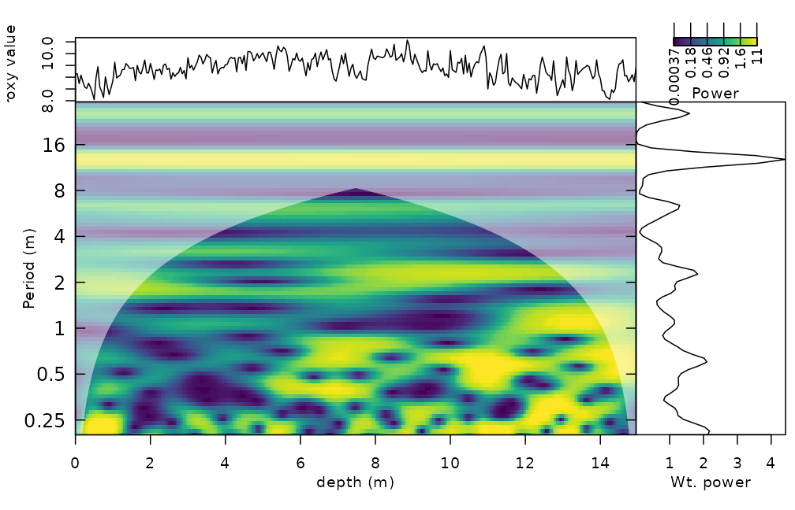
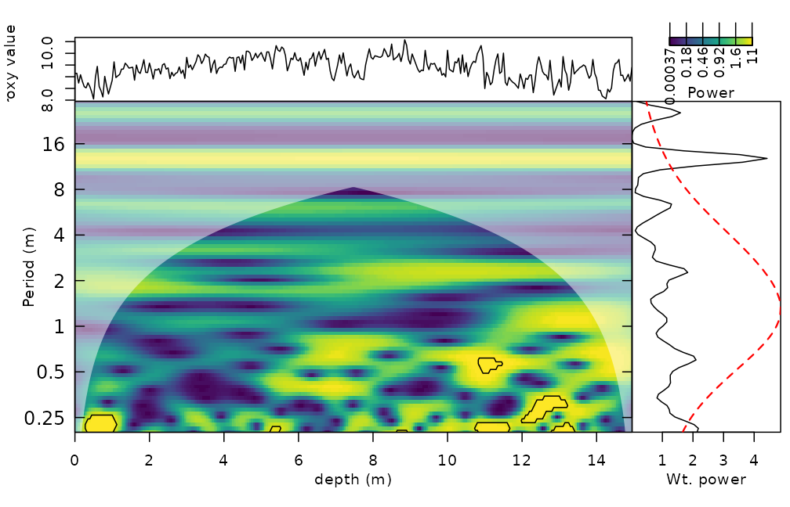
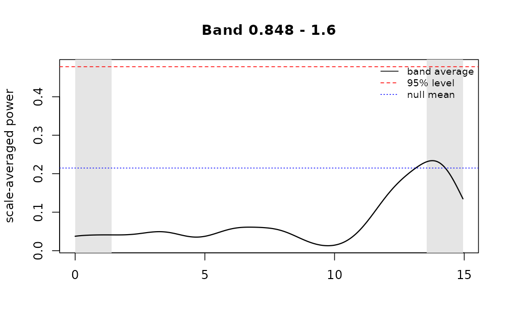
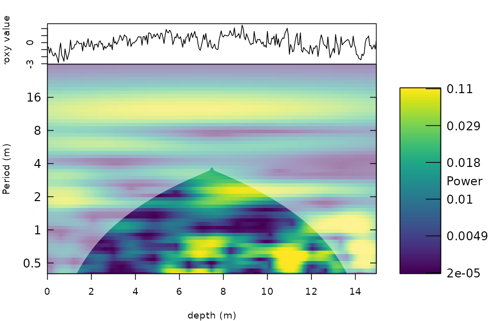

# Getting started with WaverideR

WaverideR extracts cyclic signals from stratigraphic and other time
series with the continuous wavelet transform and the superlet transform.
This vignette follows a typical cyclostratigraphic workflow on the
magnetic susceptibility record of the Sullivan core (`mag`, Pas et al.,
2018): transform, test, estimate the sedimentation rate and read off the
uncertainty. The records are shortened and the resolution is reduced so
that the vignette runs in a few seconds; use the full records and finer
settings (smaller `dj`, more simulations) for real work.

## 1. Wavelet transform

[`analyse_wavelet()`](https://stratigraphy.github.io/WaverideR/reference/analyse_wavelet.md)
takes a two-column table (depth or time, value). The record is
interpolated to its median spacing, padded, and transformed with a
Morlet wavelet. `omega_nr` is the central angular frequency of the
Morlet wavelet: a larger value gives a better resolution in period and a
poorer resolution in depth.

``` r

mag_short <- mag[1:300, ]
wt <- analyse_wavelet(data = mag_short, dj = 1/12, lowerPeriod = 0.2, upperPeriod = 32,
                      verbose = FALSE, omega_nr = 8)
plot_wavelet(wt, periodlab = "Period (m)", x_lab = "depth (m)", add_avg = TRUE)
```



The shaded area outside the dome-shaped boundary is the cone of
influence, where edge effects matter.

## 2. Is a peak significant?

[`wavelet_significance()`](https://stratigraphy.github.io/WaverideR/reference/wavelet_significance.md)
outlines the cells of the scalogram that are significant against a red
noise (AR(1)) background (Torrence and Compo, 1998) and gives the level
of the global spectrum. `method = "surrogate"` does the same with noise
surrogates that pass through the same transform, and works for superlets
too.

``` r

sig <- wavelet_significance(wt)
plot_wavelet(wt, periodlab = "Period (m)", x_lab = "depth (m)", add_avg = TRUE, add_signif = sig)
```



To test the power in a band, for example the precession band, use the
scale-averaged significance. It is valid for any `omega_nr`, because the
null distribution is derived from the wavelet itself rather than from a
fixed constant:

``` r

band <- wavelet_band_significance(wt, period_range = c(0.8, 1.6), background = "ar1")
band
#> Significance of scale-averaged wavelet power (exact, ar1 background, level 0.95)
#>   band: periods 0.8476 to 1.6 (12 scales)
#>   equivalent degrees of freedom: 5.06 
#>   expected band average under the null: 0.2147   critical value: 0.478 
#>   significant points: 0 of 242 outside the cone of influence
plot(band)
```



## 3. Superlets

Superlets combine several wavelet widths at every frequency and give a
better resolution in both period and depth. The order grows from `o[1]`
at the lowest to `o[2]` at the highest frequency. With `mult = TRUE` the
i-th wavelet has `i * c1` cycles, with `mult = FALSE` it has
`c1 + i - 1` cycles (Moca et al., 2021).

``` r

sl <- analyse_superlet(mag_short, upperPeriod = 32, lowerPeriod = 0.4, Nf = 60,
                       c1 = 3, o = c(1, 4), mult = TRUE)
plot_superlet(sl, periodlab = "Period (m)", x_lab = "depth (m)")
```



## 4. Sedimentation rate from the wavelet spectrum

[`flmw()`](https://stratigraphy.github.io/WaverideR/reference/flmw.md)
tests, for every depth and every trial sedimentation rate, how well the
expected astronomical periods (in kyr) match the peaks of the wavelet
spectrum.
[`flmw_path()`](https://stratigraphy.github.io/WaverideR/reference/flmw_path.md)
adds continuity along depth.

``` r

cycles <- c(2376, 1600, 1180, 696, 406, 110)   # periods in kyr
sr <- flmw(wavelet = wt, sedrate_low = 0.5, sedrate_high = 4, spacing = 0.5,
           cycles = cycles, x_lab = "depth", y_lab = "sedrate", run_random = FALSE,
           genplot = FALSE, plot_res = 2)
str(sr, max.level = 1)
#> List of 13
#>  $ slope_coeff_mat      : num [1:8, 1:300] 0.0914 0.1127 0.0654 0.1211 0.2011 ...
#>  $ corr_coeff_mat       : num [1:8, 1:300] 0.995 0.998 0.994 0.987 0.97 ...
#>  $ nr_compenents_mat    : num [1:8, 1:300] 5 5 4 4 3 3 3 3 5 5 ...
#>  $ orig_mat             : num [1:8, 1:300] 0.7378 0.0698 0.6328 -0.6982 -1.4504 ...
#>  $ slope_coeff_mat_per  : num [1:8, 1:300] NA NA NA NA NA NA NA NA NA NA ...
#>  $ corr_coeff_mat_per   : num [1:8, 1:300] NA NA NA NA NA NA NA NA NA NA ...
#>  $ nr_compenents_mat_per: num [1:8, 1:300] NA NA NA NA NA NA NA NA NA NA ...
#>  $ orig_mat_per         : num [1:8, 1:300] NA NA NA NA NA NA NA NA NA NA ...
#>  $ depth                : num [1:300] 0 0.05 0.1 0.15 0.2 ...
#>  $ y_axis               : num [1:8] 0.5 1 1.5 2 2.5 3 3.5 4
#>  $ score_mat            : num [1:8, 1:300] 0.754 0.738 0.619 0.578 0.387 ...
#>  $ best_sedrate         : num [1:300] 0.5 0.5 0.5 0.5 0.5 0.5 0.5 0.5 0.5 0.5 ...
#>  $ method               : chr "classic"
```

The alternative is to sum the spectral power above a red-noise
threshold. The red noise is simulated with the autocorrelation, mean and
variance of the record
([`model_red_noise_wt()`](https://stratigraphy.github.io/WaverideR/reference/model_red_noise_wt.md)),
and
[`sum_power_sedrate()`](https://stratigraphy.github.io/WaverideR/reference/sum_power_sedrate.md)
then scores each trial sedimentation rate (use many more simulations in
practice):

``` r

set.seed(1)
rn <- model_red_noise_wt(wt, n_simulations = 10)
ssr <- sum_power_sedrate(red_noise = rn, wavelet = wt, percentile = 0.75,
                         sedrate_low = 0.5, sedrate_high = 4, spacing = 0.5, cycles = cycles)
dim(ssr$power_max_mat)   # trial sedimentation rates x depths
#> [1]   8 300
```

## 5. Uncertainty of the frequency

The Morlet wavelet has a limited frequency resolution;
[`wavelet_uncertainty()`](https://stratigraphy.github.io/WaverideR/reference/wavelet_uncertainty.md)
gives the conservative analytical uncertainty for the `omega_nr` used,
which is the input for the uncertainty of age models built from tracked
periods.

## 6. Parallel computing and memory

Everything is sequential by default. Set `run_multicore = TRUE` (and
optionally `n_cores`) in the functions that offer it, or
`options(waverider.n_cores = 2)`. The number of cores is capped by the
physical cores, the free memory and the CRAN limit, and results do not
depend on it.

## References

Moca, V.V., Barbulescu, A., Nagy-Dabacan, A., Muresan, R.C. (2021).
Time-frequency super-resolution with superlets. *Nature Communications*
12, 337.

Pas, D., Hinnov, L., Day, J.E., Kodama, K., Sinnesael, M., Liu, W.
(2018). Cyclostratigraphic calibration of the Famennian stage (Late
Devonian, Illinois Basin, USA). *Earth and Planetary Science Letters*
488, 102-114.

Torrence, C. and Compo, G.P. (1998). A practical guide to wavelet
analysis. *Bulletin of the American Meteorological Society* 79, 61-78.
